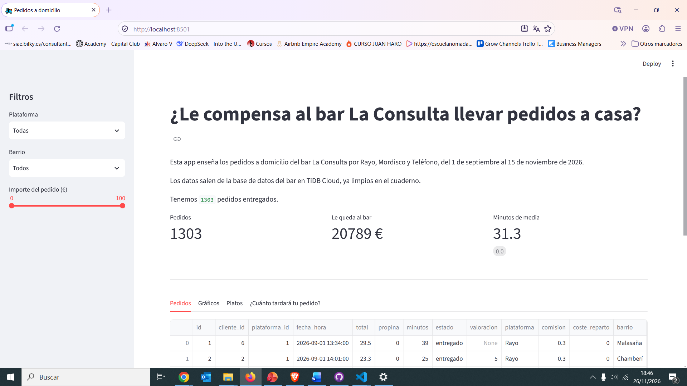

# Bar La Consulta: ¿le compensa repartir a domicilio?

Proyecto de análisis de datos con SQL, pandas y Streamlit · Valeria Ciriza · Noviembre de 2026

## De qué va el proyecto

En septiembre, el bar La Consulta empezó a llevar pedidos a casa con dos plataformas (Rayo y Mordisco) y por teléfono, con su propio repartidor. Rosa, la dueña, quiere saber si le compensa y qué tiene que cambiar.

## Los datos

Salen de una base de datos MySQL en TiDB Cloud, con los pedidos del 1 de septiembre al 15 de noviembre de 2026. Las consultas que he hecho:

- **Pedidos:** la tabla `pedidos` unida con `plataformas` (nombre, comisión y coste del reparto) y con `clientes` (barrio). 1.407 pedidos.
- **Platos:** las unidades vendidas de cada plato, uniendo `lineas` con `carta` y sumando la cantidad. 25 platos.
- **Tiempo:** la tabla `tiempo` entera, con la lluvia y la temperatura de cada día. 76 días.
- **Comprobación:** la suma del total de cada plataforma, para compararla después de limpiar.

## La limpieza

- **Totales con coma decimal** (`39,80`): cambié la coma por punto y los pasé a número. Con la coma, SQL perdía los céntimos de Mordisco.
- **Fechas en dos formatos** (Mordisco usa `15/10/2026`): las convertí por separado y las junté.
- **Estados con mayúsculas y minúsculas** (`entregado` y `Entregado`): los pasé todos a minúsculas.
- **Barrios escritos de muchas formas** (`CHAMBERÍ`, `chamberi`, `Barrio de Salamanca`…): quité espacios, pasé a minúsculas y los unifiqué con un diccionario. Quedan 5 barrios.
- **31 pedidos repetidos**: los quité. Quedan 1.376.
- **Propinas vacías**: las rellené con 0, porque significa que no dejaron.
- **9 entregas de 0 o 999 minutos**: las dejé como hueco, porque son errores del repartidor al marcar la entrega.
- **Valoraciones vacías**: las dejé como hueco, porque por teléfono no se puede valorar.
- **73 pedidos cancelados**: los separé para calcular el dinero y los tiempos. Quedan 1.303 entregados.

## Lo que he encontrado

1. **El reparto va a más:** de 57 pedidos la primera semana a 164 la última, casi el triple.
2. **Teléfono es el canal que más le deja al bar por pedido (17,73 €)**, frente a 15,87 € de Mordisco y 15,14 € de Rayo, que además cancela el 7 % de sus pedidos, casi el doble que los demás.
3. **Cuanto más tarda el pedido, peor nota:** en Chamberí se tarda unos 27 minutos y ponen un 4,7; en Lavapiés, casi 54 minutos y un 3,2.

**Recomendación:** empujar los pedidos por teléfono, quedarse con Mordisco antes que con Rayo y bajar los tiempos de entrega en Lavapiés y Salamanca.

## La app



La app lee los dos CSV limpios. Tiene filtros de plataforma, barrio e importe; métricas de pedidos, dinero y minutos; gráficos por semana, plataforma y barrio; los platos más pedidos, y una pestaña para saber cuánto tardará tu pedido según tu barrio y si llueve.

Para verla:

```
pip install pandas streamlit
streamlit run app.py
```